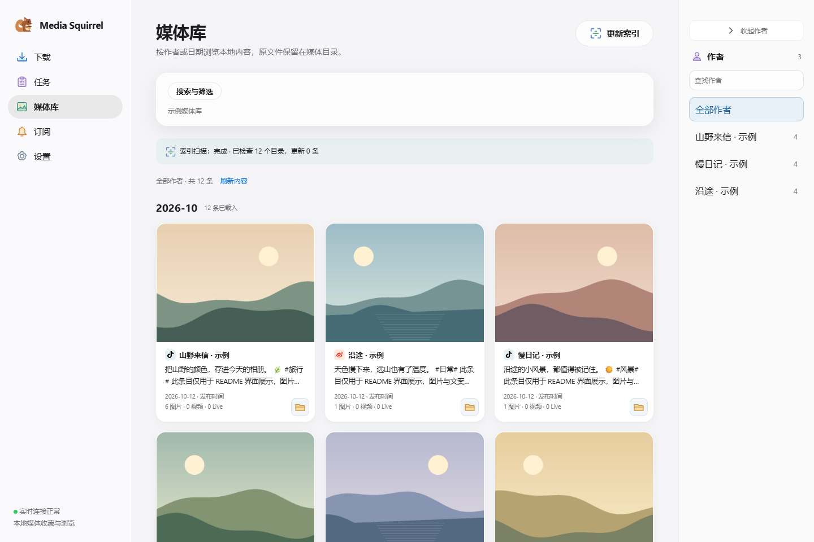
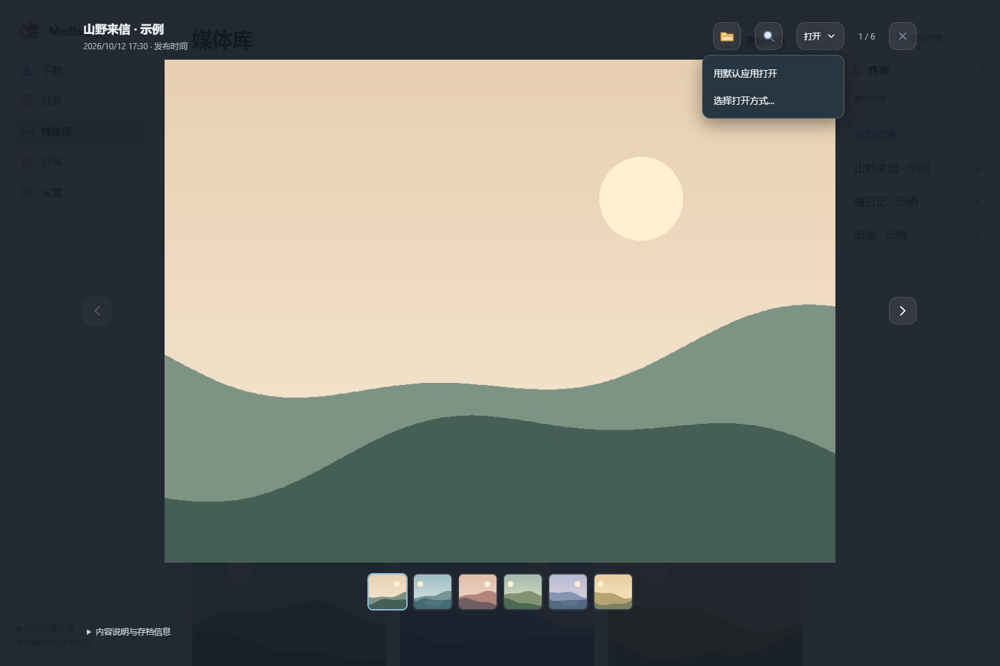

# Media Squirrel

**把微博与抖音内容存到本机，按作者和时间整理成自己的媒体库。**

下载正文、图片、Live 图、视频与图集，浏览已有存档，按计划发现订阅更新。
媒体原件保留为文件，任务、订阅和媒体索引保存在本地 SQLite。

[快速开始](#快速开始) · [界面预览](#界面预览) · [使用指南](docs/guide.md) · [参与贡献](#参与贡献)

## 适合这些场景

- 保存自己有权留存的微博或抖音作品，同时保留正文和媒体原件。
- 把已有媒体整理进相册，按作者、日期、平台或正文快速查找。
- 为关注的博主设置扫描计划，并用话题标签筛选新内容。

## 功能

- **链接下载**：微博正文、图片与 Live 图；抖音视频、图集、官方封面与正文。
- **任务管理**：下载队列、取消、进度、完成摘要、历史查询与关联重试。
- **媒体浏览**：连续滚动、作者与时间线、正文搜索，图片、视频和 Live 图统一查看。
- **博主订阅**：搜索或手动添加，间隔与固定时间计划，话题标签筛选和扫描记录。
- **数据维护**：媒体索引、复制迁移、备份恢复；执行前先预检并确认。
- **本机运行**：浏览器界面、Windows 托盘与可选开机自启动，设置页提供环境检测和诊断。

## 快速开始

先安装 Python、Node.js 和 Git，在 **Windows PowerShell** 中执行：

```powershell
git clone https://github.com/wiizZ82066/mediasqurrel.git
Set-Location mediasqurrel
python -m venv .venv
.\.venv\Scripts\python.exe -m pip install -r requirements.txt
.\.venv\Scripts\python.exe -m playwright install chromium
Set-Location frontend
npm ci
Set-Location ..
.\.venv\Scripts\python.exe run.py
```

首次启动会构建前端，默认打开 [本机网页](http://127.0.0.1:8642)，服务只绑定本机回环地址。
之后可双击 `start.bat`；已激活虚拟环境时，也可运行 `python run.py`。

实测开发环境为 **Python 3.14.2、Node.js 24.13、Vite 6.4.3**，不代表完整兼容矩阵。
浏览器要求、启动选项、依赖更新及后台运行细节见 [安装与启动](docs/guide.md#首次安装与启动windows-powershell)。

## 界面预览

以下为当前应用的实际界面截图，使用原创示例媒体数据，不含真实个人媒体。

**媒体库：** 按时间浏览内容，切换作者，展开搜索与筛选。



**内容查看器：** 切换图集，定位文件，选择本机应用打开。



## 开始使用

1. **检查环境**：打开“设置”查看环境检测与数据位置；需要登录时，从“订阅”打开对应平台登录窗口。
2. **保存内容**：在下载页粘贴作品链接，查看进度与完成结果，再定位到媒体库。
3. **浏览与订阅**：按作者或时间查看存档；添加订阅并设置计划。首次订阅扫描只建立基线，不自动下载全部历史。

默认数据与媒体目录位于 `%LOCALAPPDATA%\Media Squirrel\` 下。
已有数据的迁移请先阅读 [数据位置](docs/guide.md#数据位置) 与 [数据维护](docs/guide.md#四类数据维护)。

## 核心模块

后端使用 **Python + FastAPI**，前端使用 **Vue 3 + Vite**，默认通过 **Playwright** 访问平台。

| 模块 | 职责 |
| --- | --- |
| `run.py` | 源码启动入口与运行管理 |
| `app/task_manager.py`、`app/task_store.py` | 任务调度与日志持久化 |
| `app/catalog.py`、`app/library_service.py` | 媒体索引与浏览 |
| `app/watcher.py`、`app/scheduling.py`、`app/scanners/` | 订阅计划与平台扫描 |
| `app/maintenance.py`、`app/path_transition.py` | 数据维护与路径切换 |
| `frontend/`、`scripts_manifest/` | 浏览器界面与下载脚本注册 |

## 常见问题

### 关闭网页后，下载和扫描还会继续吗？

会。退出服务请使用托盘菜单或控制台 `Ctrl+C`。更新代码后需退出并重启服务，再完整刷新网页。
关机、休眠或应用退出期间不能扫描，恢复后按规则合并补扫；日常通知只在打开的网页内显示。

### 旧媒体和旧数据库怎样迁移？

通过“设置”预检，分别选择建立索引、升级副本、复制迁移或备份恢复。
旧数据不会自动导入，媒体原件需另行复制；详见 [四类数据维护](docs/guide.md#四类数据维护)。

### 能保证下载成功或订阅不漏抓吗？

不能。登录状态、平台限流、页面变化、内容可见性与扫描上限都会影响结果。
可结合任务和扫描记录排查，必要时用明确链接下载；详见 [扫描覆盖](docs/guide.md#订阅计划与扫描覆盖) 与 [检测与排错](docs/guide.md#检测与排错)。

## 文档导航

- [完整使用与开发指南](docs/guide.md)：保留全部功能说明、边界、命令和数据策略。
- [任务、日志与媒体浏览](docs/guide.md#任务日志与媒体浏览)：保留策略、时间线、缓存和查看器。
- [可选的抖音接口试点](docs/guide.md#可选的抖音接口试点)：Windows 实验性通道、独立配置与使用限制。
- [开发与扩展](docs/guide.md#开发与扩展)：开发启动、测试、CI 和下载脚本扩展。
- [前端设计](DESIGN.md) · [素材来源、改动与商标说明](frontend/public/licenses/README.md)。

## 参与贡献

请先阅读 [开发与扩展](docs/guide.md#开发与扩展)，提交前运行仓库检查并人工审查差异：

```powershell
python .github/scripts/check-repository.py
```

测试使用隔离目录；个人媒体、数据库、缓存、浏览器档案、Cookie、密钥和私人路径不得进入 Git。
当前主要维护源码运行方式，安装包发布、签名与桌面自动更新暂不属于本轮开发目标。

## 许可与使用范围

仓库目前没有独立的 `LICENSE` 文件；`package.json` 的构建版权字段写有 `MIT License`，项目授权范围仍待明确。
素材各自的许可、改动和商标说明见 [素材来源](frontend/public/licenses/README.md)。
请仅处理自己有权保存的内容，并遵守相关平台条款和适用法律。
